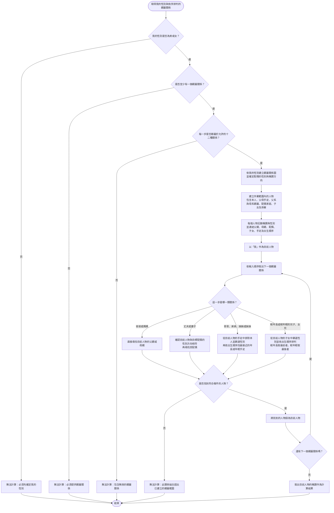

# 過年親戚聚會好幫手

親戚關係繞口又難記？「過年親戚聚會好幫手」可以按照關係順序，快速找出正確的中文親屬稱謂，拜年時不再擔心叫錯人。

## 親屬稱謂計算流程



## JavaScript 設計說明

`S1151538_HW3.js` 使用 IIFE（立即執行函式）包住整份程式，避免內部函式和狀態變數直接污染全域命名空間。整體資料流為：

```text
按鈕操作 → state.steps → evaluate() → getGraph() → resolvePath() → follow() → 親屬稱謂
```

### 對外公開的 KinshipEngine

程式只透過 `global.KinshipEngine` 公開親屬計算所需的介面：

| 成員 | 參數 | 回傳／內容 | 用途 |
| --- | --- | --- | --- |
| `evaluate(steps, rootGender)` | `steps`：關係代碼字串陣列。<br>`rootGender`：`'male'` 或 `'female'`。 | 成功時為 `{ok, code, title}`；失敗時為 `{ok, code, message}`。 | 驗證視角與關係代碼，走訪親屬圖並回傳統一格式的計算結果。 |
| `buildExpression(steps, rootGender)` | `steps`：關係代碼字串陣列。<br>`rootGender`：`'male'` 或 `'female'`。 | 關係路徑字串。 | 將結構化關係代碼轉成畫面顯示文字，例如「我（男）的媽媽的爸爸」。 |
| `relationLabels` | 無；它不是函式。 | 關係代碼到中文按鈕文字的唯讀物件。 | 讓外部程式查詢引擎支援的關係代碼及其顯示名稱。 |

`global` 會指向支援環境中的 `globalThis`，否則使用瀏覽器的 `window`。`KinshipEngine` 與 `relationLabels` 都使用 `Object.freeze()`，避免外部程式任意增加或替換公開成員。

公開介面建立後，程式才檢查 `document` 是否存在。這使親屬計算引擎可以在沒有 DOM 的測試環境中載入；畫面控制、歷史紀錄與長按處理則只會在瀏覽器內啟用。

### 為什麼檢查 document？

```javascript
if (typeof document === 'undefined') return;
```

`document` 是瀏覽器提供的 DOM 全域物件，但 Node.js 等非瀏覽器環境通常沒有它。使用 `typeof document` 檢查時，即使 `document` 根本不存在也不會拋出 `ReferenceError`。

若結果為 `undefined`，`return` 只會提前結束最外層 IIFE，不會進入取得 DOM 元素、註冊事件或渲染畫面的程式。由於 `global.KinshipEngine` 已在這行之前建立，非瀏覽器環境仍可使用 `evaluate()`、`buildExpression()` 與 `relationLabels` 進行測試。

### 結果物件與狀態代碼

`evaluate()` 與 `goBack()` 都使用相同的結果物件結構，讓 `render()` 可以依 `ok` 決定顯示成功或錯誤樣式：

| 欄位 | 出現時機 | 意義 |
| --- | --- | --- |
| `ok` | 所有結果 | `true` 表示成功找到稱謂；`false` 表示輸入或操作無法完成。 |
| `code` | 所有結果 | 供程式判斷結果類型的固定英文代碼。 |
| `title` | `ok === true` | 成功解析後的中文親屬稱謂。 |
| `message` | `ok === false` | 顯示給使用者看的中文錯誤或操作提示。 |

`evaluate()` 依序檢查視角、空輸入、關係代碼，最後才走訪親屬圖。因此同時存在多個問題時，會回傳最先遇到的錯誤。

| `code` | 來源 | 觸發參數／狀態 | `ok` | `title`／`message` |
| --- | --- | --- | --- | --- |
| `gender-required` | `evaluate()` | `rootGender` 不是 `'male'` 或 `'female'`，例如 `null`、空字串或其他值。 | `false` | `請先選擇「我（男）」或「我（女）」` |
| `gender-required` | `goBack()` | 尚未選擇視角且 `history` 為空時按返回。 | `false` | `請先選擇「我（男）」或「我（女）」` |
| `empty` | `evaluate()` | `steps` 不是陣列，或是空陣列 `[]`。 | `false` | `請先輸入至少一個親屬關係` |
| `invalid-step` | `evaluate()` | `steps` 中至少一個值不是 `RELATION_LABELS` 的鍵，例如 `['unknown']`。 | `false` | `輸入中包含無效的親屬關係` |
| `out-of-scope` | `evaluate()` | 所有關係代碼都合法，但 `resolvePath()` 在走訪時找不到符合條件的節點，例如男性視角輸入 `['husband']`。 | `false` | `這個組合不在本次作業的親屬範圍內` |
| `no-history` | `goBack()` | 已選擇合法視角，但 `history` 為空時按返回。 | `false` | `目前沒有可以返回的步驟` |
| `resolved` | `evaluate()` | 視角、關係代碼及完整路徑都有效。 | `true` | `title` 為最後節點的稱謂，例如 `妻`。 |

例如 `evaluate(['husband'], 'male')` 的兩個參數型態都正確，`husband` 也是合法關係代碼；但男性節點不能沿「丈夫」方向取得配偶，因此會得到：

```javascript
{
    ok: false,
    code: 'out-of-scope',
    message: '這個組合不在本次作業的親屬範圍內'
}
```

### 親屬圖與計算函式

大部分親屬圖 helper 只存在於 IIFE 內部；真正對外公開的只有表中標示為 `KinshipEngine 公開` 的函式：

| 函式 | 可見性 | 參數 | 回傳值 | 用途 |
| --- | --- | --- | --- | --- |
| `buildGraph(rootGender)` | IIFE 內部 | `rootGender`：`'male'` 或 `'female'`，代表「我」的性別；它也決定配偶性別及夫／妻系稱謂。 | `{root, people}`；`root` 是「我」的節點，`people` 是以 `id` 索引所有人物的 `Map`。 | 建立指定視角的完整親屬圖。 |
| `person(id, gender, title)` | `buildGraph()` 內部 | `id`：唯一字串。<br>`gender`：`'male'` 或 `'female'`。<br>`title`：此視角下的稱謂字串。 | 新建立的人物節點。 | 建立人物節點、設定初始連結欄位，並放入 `people`。 |
| `family(father, mother, children)` | `buildGraph()` 內部 | `father`、`mother`：父母人物節點。<br>`children`：依出生順序排列的子女節點陣列。 | 無。 | 連接夫妻、父母、子女、手足，並為每名子女設定 `birthOrder`。 |
| `addFourCousins(prefix, adult, spouse, familyType)` | `buildGraph()` 內部 | `prefix`：節點 ID 前綴。<br>`adult`：已知的叔伯姑舅姨節點。<br>`spouse`：其配偶節點。<br>`familyType`：`'堂'` 或 `'表'`。 | 無。 | 建立兄、姊、弟、妹四種堂／表兄弟姊妹節點，並組成家庭。 |
| `addNiblings(prefix, adult, spouse, maleTitle, femaleTitle)` | `buildGraph()` 內部 | `prefix`：節點 ID 前綴。<br>`adult`、`spouse`：夫妻節點。<br>`maleTitle`、`femaleTitle`：兒子與女兒的稱謂。 | 無。 | 建立兄弟姊妹或配偶手足的子女，並組成家庭。 |
| `getGraph(gender)` | IIFE 內部 | `gender`：`'male'` 或 `'female'`，作為快取鍵與建圖視角。 | 對應視角的 `{root, people}`。 | 從 `graphCache` 取得親屬圖；尚未建立時才呼叫 `buildGraph()`。 |
| `findSibling(person, gender, direction)` | IIFE 內部 | `person`：目前人物節點。<br>`gender`：要找的手足性別。<br>`direction`：`'older'` 或 `'younger'`。 | 符合條件且最接近的人物節點；找不到時為 `null`。 | 在 `siblings` 中排除本人，依性別與 `birthOrder` 尋找年長或年輕手足。 |
| `findChild(person, gender, direction)` | IIFE 內部 | `person`：目前人物節點。<br>`gender`：要找的子女性別。<br>`direction`：`'older'` 或 `'younger'`。 | 符合條件的子女節點；找不到時為 `null`。 | 篩選並排序 `children`；年長取第一位，年輕取最後一位。 |
| `follow(person, relation)` | IIFE 內部 | `person`：目前人物節點。<br>`relation`：`RELATION_LABELS` 中的一個關係代碼。 | 下一個人物節點；關係不成立或代碼未知時為 `null`。 | 將單一步驟轉成父母、手足、配偶或子女連結操作。 |
| `resolvePath(graph, steps)` | IIFE 內部 | `graph`：`getGraph()` 回傳的親屬圖。<br>`steps`：依輸入順序排列的關係代碼陣列。 | 最後抵達的人物節點；任一步失敗時為 `null`。 | 從 `graph.root` 開始，逐步呼叫 `follow()` 完成整條路徑。 |
| `evaluate(steps, rootGender)` | KinshipEngine 公開 | `steps`：關係代碼字串陣列。<br>`rootGender`：`'male'` 或 `'female'`。 | 包含 `ok`、`code`，以及 `title` 或 `message` 的結果物件。 | 驗證輸入，取得親屬圖並解析完整關係路徑。 |
| `buildExpression(steps, rootGender)` | KinshipEngine 公開 | `steps`：關係代碼字串陣列。<br>`rootGender`：`'male'` 或 `'female'`。 | 畫面使用的關係路徑字串。 | 使用 `RELATION_LABELS` 組合目前視角與每個關係名稱。 |

每個人物節點的主要欄位如下：

| 欄位 | 意義 |
| --- | --- |
| `id` | 節點的唯一識別字。 |
| `gender` | 人物性別，用於配偶方向與親屬條件判斷。 |
| `title` | 從目前視角稱呼此人物時顯示的親屬稱謂。 |
| `father`、`mother` | 父母節點連結。 |
| `spouse` | 配偶節點連結。 |
| `children` | 此人物的子女節點陣列。 |
| `siblings` | 與此人物同一家庭的子女陣列，包含本人。 |
| `birthOrder` | 在 `siblings`／`children` 中的順序，用來判斷長幼。 |

### 畫面、歷史與長按函式

| 函式 | 參數 | 回傳值 | 用途 |
| --- | --- | --- | --- |
| `cloneState()` | 無。 | 新的 `{rootGender, steps, result}` 狀態快照。 | 複製目前狀態，避免歷史紀錄和現行狀態共用可變資料。 |
| `performAction(change)` | `change`：不接收參數、負責修改 `state` 的 callback 函式。 | 無。 | 先將目前狀態放入 `history`，執行 `change()` 後再呼叫 `render()`；歷史最多保留 100 筆。 |
| `render()` | 無；直接讀取 `state` 與 `elements`。 | 無。 | 更新關係路徑、步數、視角、按鈕狀態、結果文字與成功／錯誤樣式。 |
| `goBack()` | 無；直接操作 `history` 與 `state`。 | 無。 | 取出並還原上一個完整操作狀態；歷史為空時顯示對應提示。 |
| `clearAllRelations()` | 無。 | 無。 | 清除關係步驟、結果與歷史，但保留已選擇的視角。 |
| `startBackPress()` | 無。 | 無。 | 重設長按旗標、顯示按壓樣式，並啟動 700ms 計時器。 |
| `endBackPress()` | 無。 | 無。 | 取消長按計時並移除按壓樣式。 |

### 關鍵變數

| 變數 | 意義 |
| --- | --- |
| `RELATION_LABELS` | 關係代碼到中文名稱的唯讀對照表，也是輸入代碼的允許清單。 |
| `VALID_GENDERS` | 可接受的視角集合：`male` 與 `female`。 |
| `graphCache` | 依視角快取已建立的親屬圖，避免每次按等號都重新建立。 |
| `elements` | 集中保存頁面上需要操作的 DOM 元素。 |
| `state` | 目前應用狀態，包含 `rootGender`、`steps` 和 `result`。 |
| `history` | `performAction()` 儲存的完整舊狀態，用於短按返回。 |
| `LONG_PRESS_MS` | 判定長按所需時間，目前為 700ms。 |
| `backPressTimer` | 長按返回所使用的計時器識別值。 |
| `longPressTriggered` | 表示長按是否已完成全清，用來抑制後續 click 造成額外返回。 |
| `keyboardPressActive` | 表示 Enter／Space 是否正處於按住狀態，避免重複 keydown 重啟計時。 |
| `suppressKeyboardClick` | 暫時忽略鍵盤操作後瀏覽器產生的 `detail = 0` 合成 click。 |
