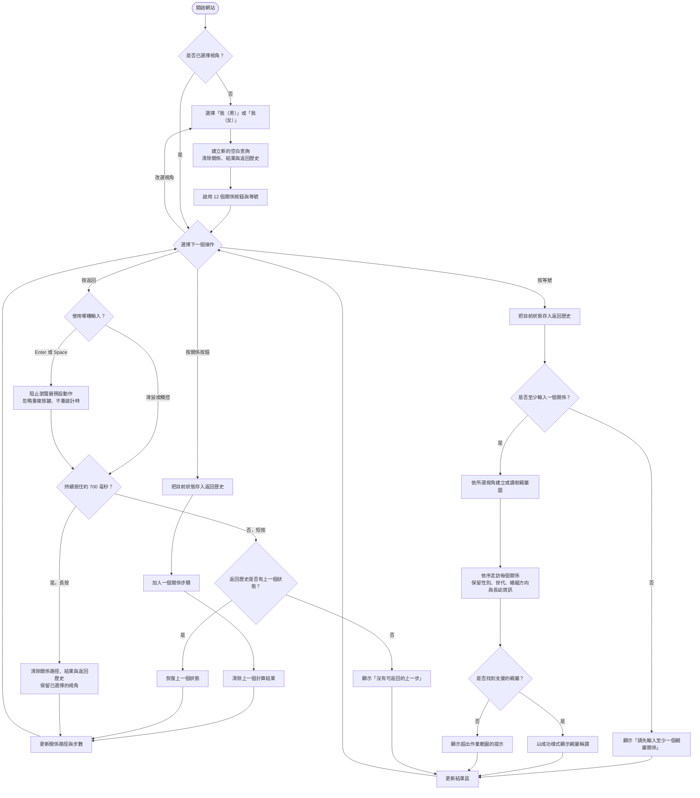

# 過年親戚聚會好幫手

親戚關係繞口又難記？「過年親戚聚會好幫手」可以按照關係順序，快速找出正確的中文親屬稱謂，拜年時不再擔心叫錯人。

## 功能特色

- 依照親屬關係逐步輸入，快速取得稱謂。
- 提供男、女兩種視角，處理不同的親屬稱呼。
- 支援父母、兄弟姊妹、配偶、子女與長幼關係。
- 可隨時返回上一步，也能長按返回一次清除整條關係。
- 支援電腦、平板與手機操作。
- 不需要註冊，也不會蒐集個人資料。

## 使用方式

1. 先選擇「我（男）」或「我（女）」。
2. 按照題目的順序，依次選擇親屬關係。
3. 按下 `=` 查看稱謂答案。
4. 按錯時短按「返回」撤銷一步；長按「返回」可全部清除。

## 詳細操作流程

## 操作範例

選擇「我（男）」後，依序按下「媽媽」、「爸爸」、「女兒（較年輕）」及 `=`，答案會顯示為「姨媽」。

## 使用提醒

本工具依課程作業指定的親屬範圍提供答案，不包含曾祖父母以上的關係或其他特殊稱謂。
